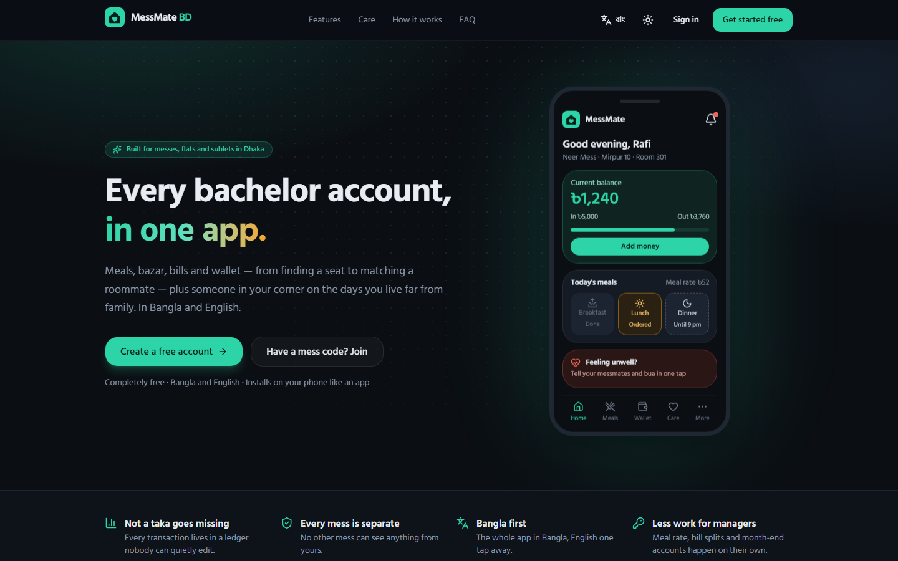
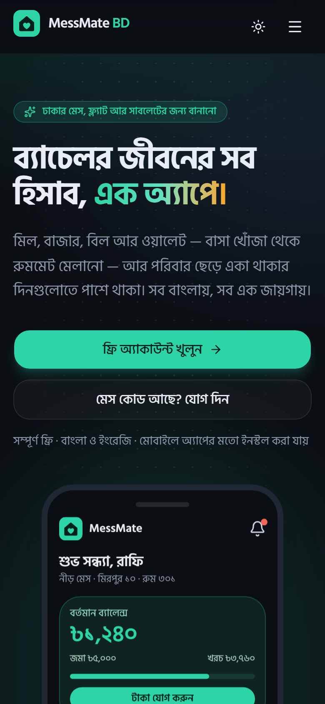
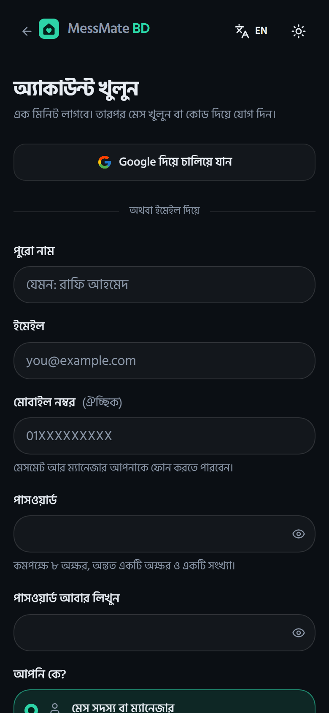
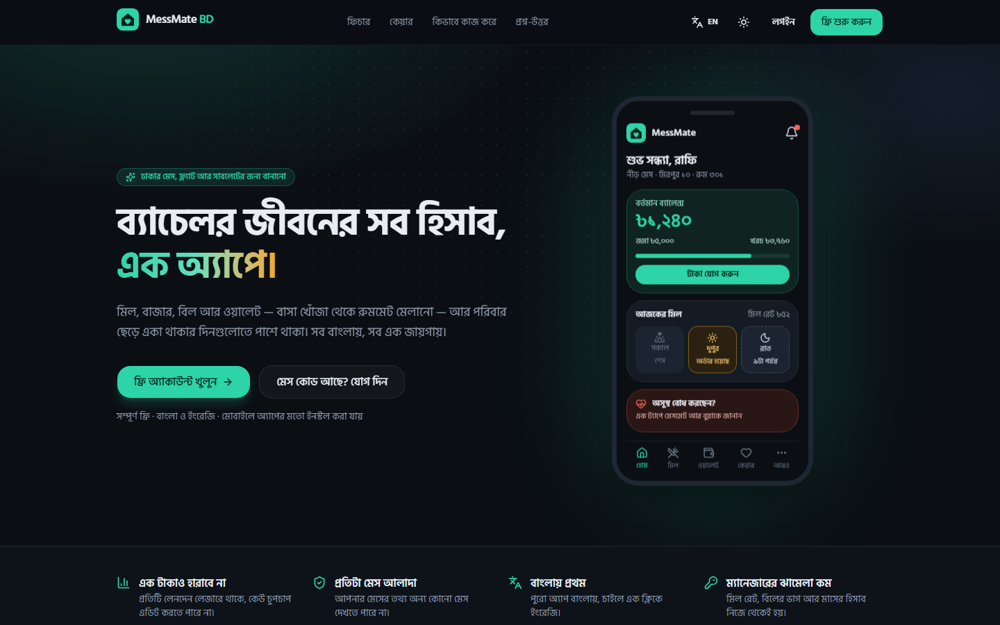
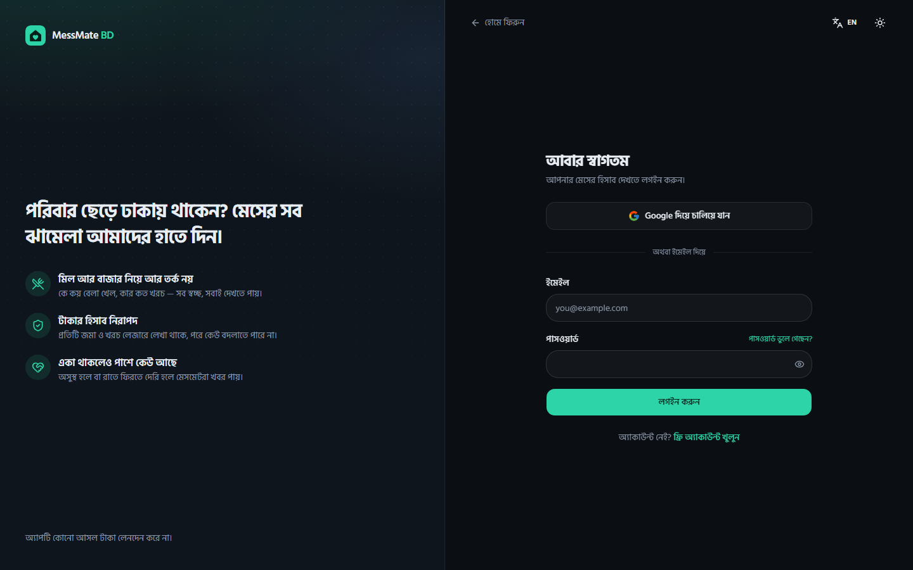
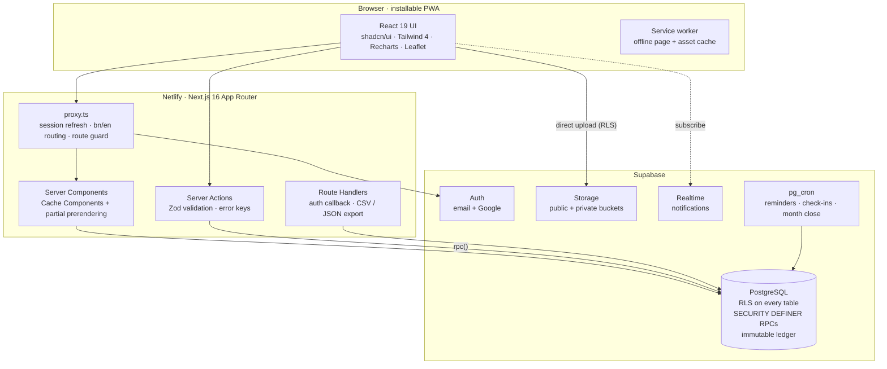
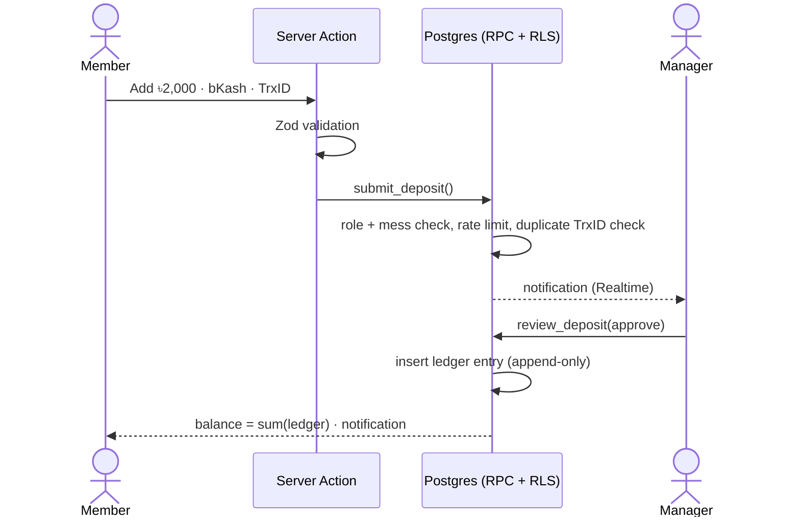

<div align="center">


# MessMate BD

**The all-in-one life platform for bachelors in Dhaka.**<br/>
ঢাকার ব্যাচেলরদের মেস, টাকা, বাসা আর একা থাকার দিনগুলোর সঙ্গী।

[](https://github.com/Majortarif/messmate-bd/actions/workflows/ci.yml)


**[🚀 Live app — messmate-bd.netlify.app](https://messmate-bd.netlify.app)**

[Deployment guide](docs/DEPLOYMENT.md) · [Testing](docs/TESTING.md) · [Security review](docs/SECURITY-REVIEW.md) · [Database docs](supabase/README.md) · [Report a bug](https://github.com/Majortarif/messmate-bd/issues)



</div>

---

## Why MessMate BD?

Thousands of students and young job-holders in Dhaka live in messes, shared flats and
sublets, far from family. Their daily life runs on paper khatas, WhatsApp groups and trust:

- Who ate how many meals, and what was the meal rate this month?
- Did my bKash payment reach the manager? Why is my balance different from his?
- How do we split the gas, wifi, bua and electricity bills fairly?
- Where is a seat for ৳4,000 in Mirpur, and who is a good roommate for me?
- Who notices if I get sick at night, or don't make it home?

MessMate BD puts all of it in one Bangla-first app that installs on any phone. It is
**multi-tenant**: any number of messes share the platform and each one is sealed off from
the others in the database itself.

## Features

| Area | What it does |
|---|---|
| 🍛 **Mess & meals** | Create a mess, share an invite code or link, approve join requests, assign rooms. Daily breakfast/lunch/dinner menu with cutoff times, one-tap ordering, guest meals, auto meal rate or fixed price. |
| 💰 **Wallet (ledger)** | Prepaid wallet topped up by bKash / Nagad / Rocket / cash with TrxID and screenshot; the manager approves by hand. Every balance is the sum of an **append-only ledger**. Corrections are reversal entries, never edits. |
| 🧾 **Bills & closing** | Bazar expenses with receipt photos, utility bills split equally, by room or custom. One-click month closing with automatic meal rate, carry-forward, printable statements and CSV export. |
| 🏠 **Housing** | Seat / room / flat / sublet listings across Dhaka areas with filters, photos and a map. Rule-based **roommate matching** score, rent & advance tracker with reminders, move-in/out checklist with a printable handover record. |
| 🛒 **Community** | Second-hand marketplace and a local services directory (bua, electrician, gas, internet, tutor, moving van…) with reviews, ratings and admin-verified badges. |
| 📢 **Mess life** | Notice board, complaint box with photos and status tracking, polls, bazar-duty and chore roster. |
| 💚 **Care** — for living alone | Sick mode and **SOS** to messmates and family (location, WhatsApp/SMS, 999), "reached home" check-ins that alert others when overdue, mood check-in and helplines, medicine/water reminders, call-home nudges, loan (dhar) tracker, month-end survival budget, tiffin & recipes, festival meetups, tuition board. Care data is visible only to its owner. |
| 📊 **Admin** | Manager dashboard with charts (daily meals, collected vs spent, expense breakdown, dues), payment approvals, reports, activity log, full CSV backup. Super admin panel for all messes, users, listing moderation and feedback. |
| 🔐 **Trust** | Plain-language Privacy Policy and Terms (Bangla + English) accepted at signup, feedback / bug report from anywhere, change password, export all my data (JSON), delete my account. |

**Roles:** Super admin · Mess manager · Member · Landlord / service provider.

## Screenshots

| Landing (Bangla, mobile) | Sign up (mobile) |
|---|---|
|  |  |

| Landing (Bangla, desktop) | Sign in |
|---|---|
|  |  |

<!--
  In-app screens (dashboard, meals, wallet, housing map, Care, admin charts) need a
  connected Supabase project. Capture them from the live site with the demo seed loaded
  and add them to docs/screenshots/.
-->

## Architecture



**How a payment moves** — the app never touches real money, but every taka is accounted for:



## Engineering highlights

- **Tenant isolation in the database.** Every mess-scoped table has Row Level Security
  bound to the caller's membership. **132 isolation checks** prove that one mess cannot
  read or write another's data. Another **147 functional checks** cover meal cutoffs,
  ledger rules, month closing and splits. All of them run in CI against the real
  migrations in an in-memory Postgres ([PGlite](https://pglite.dev)).
- **Money is a ledger.** Balances are always derived, never stored. Ledger rows cannot be
  updated or deleted, closed months reject new entries, and every money write goes
  through a `SECURITY DEFINER` function with a pinned `search_path` that re-checks the
  caller's role.
- **Defence in depth.** Zod on the client, again in server actions, and constraints in
  Postgres. Rate limits live in Postgres for deposits, joins, alerts, listings and
  feedback. RPC-only tables have no write grants at all. A production
  Content-Security-Policy and HSTS are set, storage buckets are private with signed
  URLs, and the service key is confined to one server-only module. See the
  [security review](docs/SECURITY-REVIEW.md).
- **Bangla first, for real.** Bangla URLs have no prefix and English lives under `/en`.
  2,540 translated messages are checked for parity in CI. Numbers, dates and taka amounts
  render in Bangla digits, with Hind Siliguri for typography.
- **Modern Next.js.** Next.js 16 with Cache Components and partial prerendering: a static
  shell streams instantly, personal data streams in behind Suspense skeletons.
- **Privacy by design.** Care data (mood, health alerts, check-ins, loans) is readable
  only by its owner. Managers and platform admins cannot see it. Community posts show
  short names ("Rafi A.") to strangers.
- **Phone-first.** Installable PWA, bottom navigation on mobile, client-side image
  compression before upload, dark theme by default, and `prefers-reduced-motion`
  respected.

## Tech stack

| Layer | Tools |
|---|---|
| Frontend | Next.js 16 (App Router), React 19, TypeScript, Tailwind CSS 4, shadcn/ui (Radix), Lucide |
| Forms & validation | React Hook Form, Zod 4 |
| Charts & maps | Recharts 3, Leaflet + OpenStreetMap |
| i18n | next-intl 4 (Bangla default, English) |
| Backend | Supabase: PostgreSQL, Auth (email + Google), Row Level Security, Storage, Realtime, pg_cron |
| Hosting | Netlify (Next.js adapter) + Supabase. Runs on both free tiers |
| Quality | ESLint, `tsc --noEmit`, message-parity check, PGlite SQL tests, GitHub Actions |

## Project structure

```text
messmate-bd/
├── .github/workflows/ci.yml   lint · types · build · SQL tests
├── docs/                      deployment, testing, security review, next steps, screenshots
├── messages/                  bn.json · en.json
├── public/                    PWA icons, sw.js, offline.html
├── scripts/                   message parity check, icon generator
├── src/
│   ├── app/
│   │   ├── [locale]/          (app) signed-in pages · (auth) · (print) statements
│   │   │                      landing · onboarding · join · privacy · terms · feedback
│   │   ├── api/export/        CSV / JSON downloads
│   │   └── auth/              OAuth callback · email token confirm
│   ├── components/            ui/ (shadcn) + one folder per feature
│   ├── content/legal.ts       Privacy Policy & Terms (bn + en)
│   ├── i18n/                  routing · navigation · request config
│   ├── lib/                   dal.ts · actions/ · validations/ · supabase/ · helpers
│   ├── types/                 database.ts (generated) · app.ts
│   └── proxy.ts               session refresh + locale routing + route guard
├── supabase/
│   ├── migrations/            0001 – 0020
│   ├── email-templates/       confirm signup · reset password
│   ├── setup.sql              generated one-paste bundle
│   ├── seed.sql · remove_demo.sql
│   └── tests/                 rls_isolation.sql · functional.sql · pglite runner
├── netlify.toml
└── next.config.ts
```

## Getting started

```bash
git clone https://github.com/Majortarif/messmate-bd.git
cd messmate-bd
npm install
cp .env.example .env.local   # add your Supabase URL + publishable key
npm run dev                  # http://localhost:3000  (English: /en)
```

You need a Supabase project with [`supabase/setup.sql`](supabase/setup.sql) applied. The
[deployment guide](docs/DEPLOYMENT.md) walks through all of it: the Supabase project,
Gmail SMTP, Google login, Netlify and a custom domain.

No Supabase account yet? You can still run the whole database test suite locally:

```bash
npm --prefix supabase/tests/pglite install
npm run db:test
```

| Script | Purpose |
|---|---|
| `npm run dev` | development server |
| `npm run build` · `npm start` | production build / server |
| `npm run check` | ESLint + TypeScript + Bangla/English message parity |
| `npm run db:test` | all migrations + seed + 279 SQL checks in PGlite |
| `npm run db:types` | regenerate `src/types/database.ts` |

## Honest notes

- **No real money moves.** bKash / Nagad / Rocket payments are confirmed by hand by the
  mess manager using the TrxID. The UI says so wherever money is added.
- **Free tiers.** Supabase pauses free projects after about a week without traffic, and
  Netlify's free plan has a monthly credit budget. Both are fine for a mess or a small
  community. See the deployment guide for the limits.
- **Notifications are in-app** (with Realtime). SMS and push notifications are not
  built yet.

## Roadmap

- [ ] Web push notifications (deposit approved, meal cutoff, rent, SOS)
- [ ] SMS to family for SOS and missed check-ins
- [ ] bKash / Nagad payments through a merchant account or aggregator
- [ ] Play Store app (Trusted Web Activity), receipt OCR, meal-rate forecast

Designs, costs and traps for each: [docs/NEXT-STEPS.md](docs/NEXT-STEPS.md).

## Author

**Tariful Hoque** — CSE graduate · Machine Learning & AI · Data Science · UI/UX

[Portfolio](https://updatedportfoloiwebsite.netlify.app/) ·
[LinkedIn](https://www.linkedin.com/in/tariful-hoque-582321259) ·
[GitHub](https://github.com/Majortarif) ·
[Email](mailto:tarifulhoque347@gmail.com)

## License

© 2026 Tariful Hoque. All rights reserved. The source is public for review and learning.
Please ask before reusing it in your own product.
