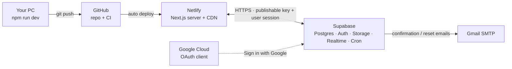

# Deploying MessMate BD

This guide takes the app from a fresh clone to a live site on your own domain, using only
free tiers. Plan for about an hour the first time.



| Step | What you do | Time |
|---|---|---|
| [1. Supabase project](#1-create-the-supabase-project) | create the project, run the SQL, set up auth, email and Google login | 25 min |
| [2. Environment variables](#2-environment-variables) | know which keys go where | 2 min |
| [3. Run locally](#3-run-locally) | `npm run dev` against your project | 5 min |
| [4. GitHub](#4-put-the-code-on-github) | push the repo, turn on CI | 5 min |
| [5. Netlify](#5-deploy-to-netlify) | import the repo, add env vars, deploy | 10 min |
| [6. Custom domain](#6-connect-a-custom-domain) | point a domain at Netlify, update auth URLs | 10 min + DNS wait |
| [7. Launch checklist](#7-launch-checklist) | make yourself admin, remove demo data, smoke test | 10 min |

**You need:** a GitHub account, a [Supabase](https://supabase.com) account, a
[Netlify](https://www.netlify.com) account, a Google account with 2-Step Verification
(for Gmail SMTP and Google login), [Node.js](https://nodejs.org) 20.9 or newer (22 LTS
recommended) and Git. A domain name is optional.

> **Rule for secrets:** only values that start with `NEXT_PUBLIC_` may reach the browser.
> The Supabase **secret** key, the database password, the Gmail app password and the Google
> client secret never go into the code, a `NEXT_PUBLIC_` variable, a screenshot or a chat.

---

## 1. Create the Supabase project

### 1.1 New project

1. Sign in at [supabase.com/dashboard](https://supabase.com/dashboard) → **New project**.
2. Name: `messmate-bd`. Region: **Southeast Asia (Singapore)** or **South Asia (Mumbai)**,
   the closest to Dhaka.
3. Generate a strong database password and keep it in a password manager. The app
   never needs it, but you will need it for backups or a future migration tool.
4. Wait about two minutes for the project to start.

### 1.2 Run the database SQL

Everything lives in [`supabase/`](../supabase). Open **SQL Editor → New query** and run
these in order:

| # | File | Notes |
|---|---|---|
| 1 | [`supabase/setup.sql`](../supabase/setup.sql) | the whole schema, RLS, functions, storage buckets, Realtime and reference data in one paste (migrations 0001–0020 except 0013) |
| 2 | — | **Database → Extensions** → enable **pg_cron** |
| 3 | [`supabase/migrations/0013_cron.sql`](../supabase/migrations/0013_cron.sql) | schedules the 5-minute and daily jobs (check-ins, reminders, month auto-close, rent reminders, cleanup) |
| 4 | [`supabase/seed.sql`](../supabase/seed.sql) | *optional* demo data: 2 messes, 17 users, 60 days of history. Every demo password is `Demo@12345` (manager `rafi@messmate.demo`) |
| 5 | [`supabase/tests/rls_isolation.sql`](../supabase/tests/rls_isolation.sql), [`functional.sql`](../supabase/tests/functional.sql) | *optional* proof on the real database. Each cleans up after itself and ends with a row like `RLS isolation: 132 checks passed` |

`setup.sql` is long; paste all of it and press **Run** once. A green "Success. No rows
returned" means it worked.

> **Already ran an older `setup.sql`?** Don't run it again. Run only the newer files from
> `supabase/migrations/` one by one, in order (for example `0014` → `0020`).

Check the cron jobs exist:

```sql
select jobname, schedule from cron.job;   -- messmate-every-5-min, messmate-daily
```

### 1.3 Copy the API keys

**Project Settings → API Keys** (the project URL is under **Project Settings → Data API**,
or the **Connect** button):

| Value | Looks like | Where it goes |
|---|---|---|
| Project URL | `https://abcdefghijklmnop.supabase.co` | `NEXT_PUBLIC_SUPABASE_URL` |
| Publishable key | `sb_publishable_…` (older projects: the `anon` key) | `NEXT_PUBLIC_SUPABASE_PUBLISHABLE_KEY` (or `NEXT_PUBLIC_SUPABASE_ANON_KEY`) |
| Secret key | `sb_secret_…` (older projects: `service_role`) | `SUPABASE_SECRET_KEY`, **server only** |

The publishable key is safe in the browser because every table is protected by Row Level
Security. The secret key bypasses RLS; the app uses it in exactly one place
([`src/lib/supabase/admin.ts`](../src/lib/supabase/admin.ts)) to remove the login when a
user deletes their account.

### 1.4 Auth URLs

**Authentication → URL Configuration**

- **Site URL:** your production address, for example `https://messmate-bd.netlify.app`
  (later your custom domain). While you only run locally, use `http://localhost:3000`.
  Email links are built from this value.
- **Redirect URLs:** add every address the app runs on:

  ```text
  http://localhost:3000/**
  https://messmate-bd.netlify.app/**
  https://deploy-preview-*--messmate-bd.netlify.app/**
  https://yourdomain.com/**
  https://www.yourdomain.com/**
  ```

  Replace `messmate-bd` with your Netlify project name and `yourdomain.com` with your
  domain (add those two once you have them).

### 1.5 Email sign-in and password rules

**Authentication → Sign In / Providers → Email**

- **Enable email provider:** on. **Confirm email:** on.
- **Minimum password length:** `8` (the app also asks for at least one letter and one number).

### 1.6 Send emails through Gmail (SMTP)

Supabase's built-in mailer only sends to your own team's addresses, so real users need
custom SMTP. A Gmail account works on the free tier (about 500 emails a day).

1. In your Google Account → **Security**, turn on **2-Step Verification**, then open
   **App passwords** and create one called `MessMate Supabase`. Copy the 16 characters
   (no spaces).
2. Supabase → **Authentication → Emails → SMTP Settings** → **Enable custom SMTP**:

   | Field | Value |
   |---|---|
   | Sender email | your Gmail address |
   | Sender name | `MessMate BD` |
   | Host | `smtp.gmail.com` |
   | Port | `465` |
   | Username | your Gmail address |
   | Password | the 16-character app password |

3. **Authentication → Rate Limits:** raise "emails sent per hour" from the default to
   something like `100` so a busy evening of sign-ups is not blocked.

When the app grows, swap Gmail for a transactional provider (Resend, Brevo, Amazon SES);
only these SMTP fields change.

### 1.7 Email templates

The default links use a browser-bound code, so they fail when someone signs up on a laptop
and opens the email on a phone. The app ships token-hash templates that work anywhere.

**Authentication → Emails → Templates**:

| Template | Subject | Message body |
|---|---|---|
| Confirm signup | `MessMate BD — ইমেইল নিশ্চিত করুন / Confirm your email` | paste [`supabase/email-templates/confirm-signup.html`](../supabase/email-templates/confirm-signup.html) |
| Reset password | `MessMate BD — নতুন পাসওয়ার্ড দিন / Reset your password` | paste [`supabase/email-templates/reset-password.html`](../supabase/email-templates/reset-password.html) |

Both link to `/auth/confirm`, which verifies the token and opens onboarding or the
new-password page. People who signed up in English land on the `/en` version.

### 1.8 Sign in with Google

1. Go to [console.cloud.google.com](https://console.cloud.google.com) and create a project
   named `MessMate BD`.
2. **Google Auth Platform → Branding:** app name `MessMate BD`, your support email, and
   the links to your home page, `/privacy` and `/terms`. Under **Authorized domains** add
   your Supabase domain (`abcdefghijklmnop.supabase.co`), `netlify.app` and later your own
   domain.
3. **Audience:** user type **External**, then **Publish app**. The app only asks for the
   basic `openid`, `email` and `profile` scopes, so Google does not need to review it.
4. **Clients → Create client → Web application:**
   - **Authorized JavaScript origins:** `http://localhost:3000`,
     `https://messmate-bd.netlify.app`, later `https://yourdomain.com`.
   - **Authorized redirect URIs:** `https://abcdefghijklmnop.supabase.co/auth/v1/callback`
     (your project URL + `/auth/v1/callback`).
5. Copy the **Client ID** and **Client secret** into Supabase → **Authentication →
   Sign In / Providers → Google**, turn it on and save.

---

## 2. Environment variables

The full list lives in [`.env.example`](../.env.example).

| Variable | Required | Browser-visible | Used for |
|---|---|---|---|
| `NEXT_PUBLIC_SUPABASE_URL` | yes | yes | Supabase client, Storage image URLs (read at **build** time too) |
| `NEXT_PUBLIC_SUPABASE_PUBLISHABLE_KEY` | yes | yes | Supabase client. Older projects may set `NEXT_PUBLIC_SUPABASE_ANON_KEY` instead |
| `NEXT_PUBLIC_SITE_URL` | yes | yes | invite links, social cards, fallback for auth redirects. No trailing slash |
| `NEXT_PUBLIC_SUPPORT_EMAIL` | recommended | yes | shown on Privacy, Terms and Feedback pages |
| `SUPABASE_SECRET_KEY` | for account deletion | **no** | removes the auth user on "Delete my account". Without it, personal data is still wiped but the login stays |

`NEXT_PUBLIC_*` values are baked into the JavaScript at build time. After changing one on
Netlify, trigger a new deploy.

---

## 3. Run locally

```bash
git clone https://github.com/Majortarif/messmate-bd.git
cd messmate-bd
npm install
cp .env.example .env.local      # Windows PowerShell: Copy-Item .env.example .env.local
```

Fill in `.env.local` with the values from 1.3, then:

```bash
npm run dev
```

Open [http://localhost:3000](http://localhost:3000) (Bangla) or
[http://localhost:3000/en](http://localhost:3000/en) (English). With the seed loaded, sign in
as `rafi@messmate.demo` / `Demo@12345` to see a manager's view.

| Command | What it does |
|---|---|
| `npm run dev` | dev server with hot reload |
| `npm run build` / `npm start` | production build and server (the service worker and "Install app" only work here) |
| `npm run check` | ESLint + TypeScript + Bangla/English message parity |
| `npm run db:test` | every migration, the seed and both SQL test suites in in-memory Postgres (PGlite); no Supabase account needed. Run `npm --prefix supabase/tests/pglite install` once first |
| `npm run db:types` | regenerates `src/types/database.ts` from the migrations |
| `npm run icons` | regenerates the PWA icons from `public/icons/icon.svg` |

---

## 4. Put the code on GitHub

1. On GitHub → **New repository** → name `messmate-bd`, **no** README, license or
   .gitignore (the project already has them).
2. Push:

   ```bash
   git remote add origin https://github.com/Majortarif/messmate-bd.git
   git branch -M main
   git push -u origin main
   ```

   `.env.local` is ignored by `.gitignore`; run `git status` before every commit to be
   sure no secret file is staged.
3. **Repository → About (gear icon):** description *"All-in-one life platform for
   bachelors in Dhaka — meals, wallet, bills, housing, roommates and Care. Next.js +
   Supabase, Bangla-first PWA."*, website = your live URL, topics `nextjs`, `supabase`,
   `typescript`, `tailwindcss`, `postgresql`, `row-level-security`, `pwa`, `i18n`,
   `bangladesh`, `dhaka`.
4. **Settings → General → Social preview:** upload
   [`public/icons/og.png`](../public/icons/og.png) (1200 × 630).
5. The workflow in [`.github/workflows/ci.yml`](../.github/workflows/ci.yml) runs on every
   push and pull request: lint, types, message parity, production build and the 279 SQL
   checks. Its badge is at the top of the README.
6. Pin the repository on your profile.

---

## 5. Deploy to Netlify

1. [app.netlify.com](https://app.netlify.com) → **Add new project → Import an existing
   project → GitHub**, authorise, and pick `messmate-bd`.
2. Netlify reads [`netlify.toml`](../netlify.toml): build command `npm run build`, publish
   directory `.next`, Node 22. Netlify's Next.js adapter (OpenNext) is picked up
   automatically. Server rendering, server actions, the `proxy.ts` session refresh, image
   optimisation and Cache Components all run on it. Leave these settings as they are.
3. Set a project name (for example `messmate-bd`) so the address becomes
   `https://messmate-bd.netlify.app`.
4. Before the first deploy, open **Add environment variables** (later: **Project
   configuration → Environment variables**) and add the five variables from section 2.
   Set `NEXT_PUBLIC_SITE_URL` to the netlify.app address.
5. **Deploy.** The first build takes 3–5 minutes.
6. Go back to Supabase (1.4) and Google (1.8) and make sure the netlify.app address is in
   the Site URL, Redirect URLs and JavaScript origins.

Every push to `main` now deploys automatically, and pull requests get a deploy preview.

**Free plan notes**

- Netlify's free plan is credit-based (300 credits a month at the time of writing). A
  successful production deploy costs 15 credits, and bandwidth, compute and requests also
  draw from the same pool. Deploy previews are free. Push to `main` in batches rather than
  after every tiny change, and keep an eye on **Usage & billing**.
- If a build stops at **secrets scanning** because it found the Supabase URL or
  publishable key in the output, that is expected: both are public by design. Add an
  environment variable `SECRETS_SCAN_OMIT_KEYS` =
  `NEXT_PUBLIC_SUPABASE_URL,NEXT_PUBLIC_SUPABASE_PUBLISHABLE_KEY` and redeploy. Never
  add `SUPABASE_SECRET_KEY` to that list.
- Free Supabase projects pause after about a week without traffic. A paused project
  can be restored from the dashboard; cron jobs catch up on the next run.

---

## 6. Connect a custom domain

1. Buy a domain from any registrar (Namecheap, Porkbun, Cloudflare Registrar, or a local
   `.com.bd` registrar).
2. Netlify → **Domain management → Add a domain** → enter `yourdomain.com`.
3. Point DNS at Netlify. Pick **one** option:
   - **Netlify DNS (simplest):** Netlify shows four name servers. Put them in your
     registrar's name-server settings.
   - **Keep your registrar's DNS:**

     | Type | Host | Value |
     |---|---|---|
     | `A` | `@` | `75.2.60.5` (or an `ALIAS`/`ANAME` to `apex-loadbalancer.netlify.com` if offered) |
     | `CNAME` | `www` | `messmate-bd.netlify.app` |

4. DNS can take up to 24 hours. Netlify then issues a free Let's Encrypt certificate.
   Check **HTTPS → Verify DNS configuration** if it doesn't.
5. Update the app for the new address:
   - Netlify env var `NEXT_PUBLIC_SITE_URL` = `https://yourdomain.com`, then
     **Deploys → Trigger deploy**.
   - Supabase **Site URL** = `https://yourdomain.com`. Keep the netlify.app and localhost
     entries in **Redirect URLs**.
   - Google OAuth client: add `https://yourdomain.com` to the JavaScript origins and the
     domain to **Branding → Authorized domains**.
   - Netlify → Domain management: set `yourdomain.com` as the **primary domain** so the
     netlify.app address redirects to it.

---

## 7. Launch checklist

- [ ] Sign up with your own email and confirm it from your phone (tests SMTP + templates).
- [ ] Make yourself the platform owner, then reload; an **Admin** section appears in the sidebar:

  ```sql
  update public.profiles set platform_role = 'super_admin' where email = 'you@example.com';
  ```

- [ ] Sign in with Google in a private window.
- [ ] "Forgot password" email arrives and the link opens the new-password page.
- [ ] Create a mess, copy the invite link, join from a second account, approve, add money, approve the deposit.
- [ ] Install the app from the browser menu ("Add to Home screen") on Android and iOS.
- [ ] **Demo data:** every seeded account shares the public password `Demo@12345`, and
  demo users can post in the community areas real users see. Before sharing the link
  with real users, run [`supabase/remove_demo.sql`](../supabase/remove_demo.sql). For a
  portfolio demo, keep it in a **second** free Supabase project behind a second Netlify
  site.
- [ ] Set `NEXT_PUBLIC_SUPPORT_EMAIL` so people can reach you.

---

## Updating the live app

- **Code:** push to `main`; Netlify rebuilds. Use a branch + pull request to get a free
  deploy preview first.
- **Database:** add a new numbered file in `supabase/migrations/`, run `npm run db:test`
  (it re-runs everything and regenerates `setup.sql`), commit, then paste only the new file
  into the Supabase SQL editor. Never edit a migration that already ran in production.
- **Backups:** managers can download a mess's full CSV backup from **Manage → Reports**.
  For the whole database, use `pg_dump` with the connection string from **Connect**
  (free projects have no automatic backups).

## Troubleshooting

| Symptom | Likely cause and fix |
|---|---|
| "The server isn't set up yet (Supabase isn't configured)" | `NEXT_PUBLIC_SUPABASE_URL` or the publishable key is missing. Add it and redeploy (build-time value). |
| Email link says the link is invalid or expired | The link was already used, is older than an hour, or the template still uses `{{ .ConfirmationURL }}`. Paste the templates from 1.7 and check the Site URL. |
| No confirmation email | Check the Gmail app password and port 465 in SMTP settings, the spam folder, and **Authentication → Logs**. |
| Google: `redirect_uri_mismatch` | The Google client is missing `https://<ref>.supabase.co/auth/v1/callback`. |
| After Google sign-in you land on localhost | The live address is missing from Supabase **Redirect URLs**, so Supabase fell back to the Site URL. |
| Profile or listing photos don't load | `NEXT_PUBLIC_SUPABASE_URL` was not set when the site was **built**. Both the image host allow-list and the Content-Security-Policy are generated from it. Redeploy. |
| "Delete my account" leaves the login working | `SUPABASE_SECRET_KEY` is not set on Netlify. Personal data was still wiped. |
| Reminders and check-in alerts never fire | pg_cron is off or `0013_cron.sql` was not run. Check `select * from cron.job_run_details order by start_time desc limit 5;`. |
| Build fails at secrets scanning | See the Free plan notes in section 5. |
