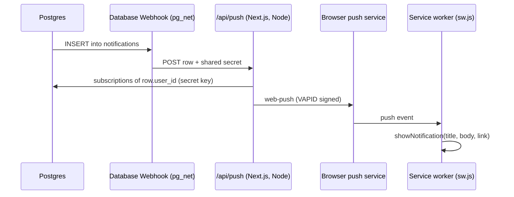
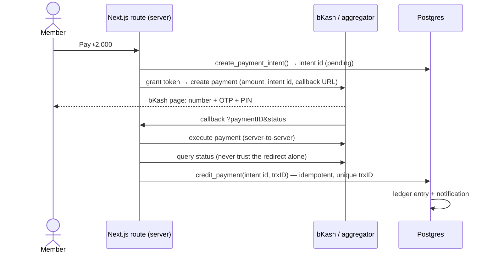

# Next steps

What to build after the first release, ordered by value for users and by how well it fits
the free tiers. Each idea notes the design, the cost and the traps.

| Priority | Idea | Why | Cost |
|---|---|---|---|
| **Now** | [Web push notifications](#1-web-push-notifications) | deposit approved, meal cutoff, SOS: people miss in-app bells | free |
| **Now** | [Error monitoring + nightly backups](#4-operations) | free Supabase has no automatic backups | free |
| **Next** | [SMS for emergencies](#2-sms-for-emergencies-and-family) | reach family members who don't use the app | ~paisa per SMS, prepaid |
| **Next** | [Play Store app (TWA)](#5-more-ideas) | trust and discoverability in Bangladesh | $25 one-time |
| **Later** | [bKash / Nagad payments](#3-bkash--nagad-payment-api) | no more manual TrxID checks | merchant fees + compliance |
| **Later** | [Receipt OCR, forecasts, smarter matching](#5-more-ideas) | less typing for managers | free (on-device) |

---

## 1. Web push notifications

Today every notification is a row in `public.notifications`, shown by the bell through
Supabase Realtime. That works only while the app is open. Web Push reaches a phone even
when the app is closed. It works on Android Chrome, desktop browsers and iOS 16.4+ once
the PWA is added to the Home Screen.

**Build it:**

1. **Keys.** `npx web-push generate-vapid-keys`. Put the public key in
   `NEXT_PUBLIC_VAPID_PUBLIC_KEY` and the private key in `VAPID_PRIVATE_KEY` (server only).
2. **Table.** Migration `push_subscriptions (id, user_id, endpoint unique, p256dh, auth,
   user_agent, created_at)`. RLS: owner can insert, select and delete their own rows.
3. **Subscribe.** A toggle in **Settings → Notifications** calls
   `registration.pushManager.subscribe({ userVisibleOnly: true, applicationServerKey })`
   and saves the subscription. Ask only after the user taps it, never on page load.
4. **Service worker.** Add `push` and `notificationclick` handlers to
   [`public/sw.js`](../public/sw.js). Clicking opens `data.link`.
5. **Send.** A Supabase **Database Webhook** on `notifications` INSERT posts to
   `/api/push`. The route checks a shared secret, loads the user's subscriptions with
   the secret key, sends with the `web-push` package, and deletes subscriptions that
   return 404/410.
6. **Preferences.** A `notification_prefs` JSON column on `profiles` (meals, money,
   community, Care). Care alerts (SOS, missed check-in) are always on.

**Free tier:** Database Webhooks and Netlify Functions are both included. Push messages
cost nothing.

## 2. SMS for emergencies and family

Push needs the app. A guardian in the village does not have it. Use SMS only where it
matters: **SOS, sick mode and a missed "reached home" check-in**, sent to the emergency
contacts the user already saves in Care. Phone number verification by OTP at signup is a
second use.

**Build it:**

- **Provider.** Pick a Bangladeshi SMS gateway with an HTTP API and a prepaid balance;
  several local providers sell non-masked SMS for a few paisa each. A masked sender name
  ("MessMate") needs approval through the provider and costs more. Twilio works too but
  costs far more per SMS to Bangladesh.
- **Queue.** Add an `sms_outbox (id, to_phone, body, kind, status, attempts, created_at)`
  table, written only by RPCs. A cron job or webhook sends pending rows through a server
  route holding the API key, with retries and a per-user daily cap (e.g. 5) so a stuck
  phone can't drain the balance.
- **Consent.** The user adds the contact and confirms they agreed to receive alerts. Every
  SMS ends with "MessMate BD alert for <name>", and the user can turn SMS off.
- **Text.** Bangla SMS is Unicode (70 characters a part), so keep it short: name, what
  happened, a map link, and "call 999 if serious".
- **Cost control.** A monthly budget in env (e.g. 500 SMS). When it is reached, fall back
  to push and in-app, and email the owner.

## 3. bKash / Nagad payment API

Right now members send money to the manager's personal bKash and the manager checks the
TrxID by hand. The app never touches money. Automating this is the most requested
improvement and the most delicate one.

**The real constraint is legal, not technical.** Personal bKash accounts have no public
API to look up incoming transactions. Automatic payments need a merchant account, and
then the money lands in that merchant's account:

| Option | How money flows | Fit |
|---|---|---|
| A. Each manager has a bKash merchant account and enters API keys | member → manager's merchant account | best fit, but few managers have a trade licence |
| B. A payment aggregator with bKash, Nagad and cards (e.g. SSLCommerz, aamarPay, ShurjoPay) and per-mess settlement | member → aggregator → manager | realistic once a registered business runs MessMate |
| C. Platform collects and pays managers out | member → platform → manager | needs a licence for holding other people's money; avoid |

**When there is a legal entity (option B or A), the flow is:**

**Rules for whoever builds it:**

- Keep API keys and secrets server-side only, and keep sandbox and live credentials apart.
- **Never credit from the browser redirect.** Credit only after the server-to-server
  execute and status query. Store `paymentID`/`trxID` unique so a replayed callback
  credits once.
- A reconciliation cron that queries `pending` intents older than 15 minutes.
- The ledger stays the single source of truth. A payment is just another ledger
  `deposit` with `source = 'bkash_api'`.
- Show the fee to the member before paying. Keep the manual TrxID path for cash and for
  messes without a merchant account.

## 4. Operations

- **Error monitoring.** Sentry's free tier for Next.js catches client and server
  exceptions with the page and release. Strip emails, phones and TrxIDs in `beforeSend`.
  Add its ingest host to the CSP `connect-src`.
- **Nightly backups.** A scheduled GitHub Action runs `pg_dump` with a read-only database
  role and stores the encrypted dump as a private artifact (or in a private bucket).
  Restore it into a scratch project once a month.
- **Uptime.** Add a tiny `/api/health` route that makes one Supabase query, and point a
  free uptime monitor at it every few minutes. It watches the whole stack and also keeps a
  free Supabase project from pausing.
- **Supabase Pro** when real messes depend on it: daily backups, no pausing, and leaked-
  password protection.

## 5. More ideas

- **Play Store app.** Wrap the PWA as a Trusted Web Activity (Bubblewrap / PWABuilder).
  It is the same code, gets a store listing, and push works like a native app.
- **Receipt OCR for bazar.** Read the total and items from a receipt photo in the browser
  (Tesseract.js with the Bengali model) and prefill the expense form. The manager confirms.
- **Meal-rate forecast.** Predict this month's rate from orders so far and past months
  (simple regression on `meal_orders` + `expenses`), shown on the manager dashboard.
- **Smarter roommate matching.** Learn weights from which matches people actually message
  or move in with, on top of the current rule-based score.
- **Offline meal orders.** Queue order toggles in IndexedDB and sync with Background Sync
  when the connection returns. Cutoff is checked by the server as today.
- **Verified landlords.** Super-admin verification (phone call or NID check) with a badge,
  like services already have.
- **WhatsApp notices.** Share a notice or monthly statement to the mess WhatsApp group with
  one tap (share links, no API needed).
